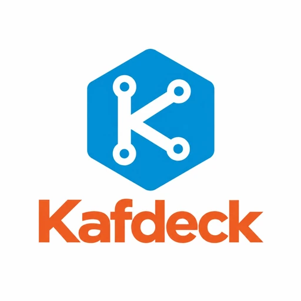
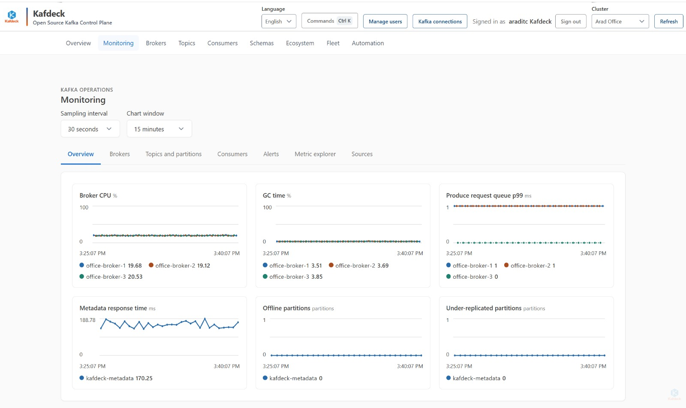

# Kafdeck

**The Open Source Kafka Control Plane**

Inspect, monitor and manage Apache Kafka from one self-hosted control plane.

[Getting Started](#getting-started) ·
[Features](#feature-matrix) ·
[Fleet](#fleet-broker-host-management) ·
[Configuration](#configuration) ·
[Security](#security-model) ·
[Contributing](#contributing) ·
[Support](#support)

---

Kafdeck is a self-hosted, vendor-neutral control plane for Apache Kafka. Use the dashboard to inspect clusters, browse records with server-side masking, diagnose consumer lag, monitor broker health and manage authorized changes. Kafdeck runs outside the Kafka message path. Read-only operation is the default, and governed changes are opt-in.

> [!IMPORTANT]
> **Latest stable release: [Kafdeck v1.1.0](https://github.com/araditc/Kafdeck/releases/tag/v1.1.0).** [Install or upgrade](docs/operator/v1.1-installation-guide.md) · [Create the first administrator](docs/operator/managed-identity-setup.md) · [Fleet quickstart](docs/operator/v1.1-fleet-quickstart.md) · [Release evidence](docs/releases/v1.1.md).

For a fresh Windows Server or an existing Windows Services installation, use the supplementary 1.1.0 offline bundle and its checksum. The bundled native application comes from the signed stable release. [Windows offline installation](docs/operator/windows-offline-install.md) · [Windows offline upgrade](docs/operator/windows-offline-upgrade.md) · [Kafka agent guide](docs/operator/kafka-agent.md). The original Windows supplement and standalone agent ZIP are available from the [v1.0.0 release](https://github.com/araditc/Kafdeck/releases/tag/v1.0.0).

*Monitoring dashboard with live observations from a three-broker Kafka cluster. Chart availability depends on the configured sources and Kafka/JVM metrics.*

## Why Kafdeck?

- **Safe by default** — bounded work, cancellation, deadlines, rate/byte limits, per-cluster isolation, and fail-closed behavior.
- **Read access is not data access** — metadata permissions never automatically grant Kafka payload visibility.
- **Server-side masking** — sensitive record data is redacted before it reaches the browser, API client, or export path.
- **No mandatory data-plane proxy** — Kafdeck stays out of the Kafka message path.
- **Zero-write observation** — read-only Kafdeck does not create internal Kafka topics or need Kafka write access to store its own state.
- **Vendor-neutral core** — Apache Kafka semantics define the baseline; ecosystem/provider integrations are capability-gated.
- **On-premise and air-gapped friendly** — core runtime functionality has no required SaaS dependency.
- **Governed OSS engineering** — architecture, security, compatibility, release evidence, and project decisions are versioned in the repository.

Use the [documentation index](docs/README.md) for operator and contributor guides, the [roadmap](ROADMAP.md) for planned work, and the [v1.1.0 release notes](publication/v1/release-notes-1.1.0.md) for this release.

## Feature matrix

The sections below describe the capabilities shipped in **v1.1.0**. Availability depends on configuration, provider support and the operator's permissions.

### Cluster and broker operations

- multiple static Kafka profiles and owner-registered connections with test-before-save and dashboard cluster selection,
- broker/controller metadata,
- topics, partitions, leaders, replicas and ISR,
- topic and broker configuration inspection where authorized/supported,
- evidence-based cluster/partition health,
- bounded snapshots, deadlines, cancellation, stale/partial semantics and per-cluster isolation.

### Identity, authorization and audit

- Local, deployment-token and OIDC access modes,
- Keycloak first-owner setup with a local one-time code, managed users and cluster assignments,
- safe recovery of interrupted managed-user creation and audit of Kafka connection registration,
- OIDC Authorization Code + PKCE with server-side sessions,
- immutable default-deny RBAC in OIDC mode,
- subject/group bindings,
- action-, cluster- and resource-scoped authorization,
- backend-authoritative enforcement for UI and API clients,
- structured security audit events,
- deployment access tokens held in page memory only after URL-fragment bootstrap.

### Safe Data Explorer and masking

- bounded record browsing by topic/partition,
- earliest/latest/offset/timestamp navigation and previous-page reads,
- bounded live tail,
- key/value/header inspection,
- raw, UTF-8, binary/hex and structured projections,
- Schema Registry-assisted Avro / Protobuf / JSON Schema decoding,
- controlled CBOR / XML / MessagePack SerDe,
- bounded filtering,
- explicit record/byte/time/rate/concurrency budgets,
- server-side masking before UI/API/export,
- separate `record.read` and `record.export` authorization,
- bounded JSON / NDJSON / CSV export,
- no payload persistence by default.

### Consumers and diagnostics

- consumer groups, states, members and assignments,
- committed/end offsets and per-partition/aggregate lag,
- explicit missing / unauthorized / out-of-range states,
- evidence-based inactive/stalled diagnostics,
- live offset and lag observations with explicit reasons for incomplete data,
- governed offset reset and group deletion where the configured permissions and broker support permit them.

### Schema Registry lifecycle and developer tooling

- subjects, versions, schema IDs, formats, content and references,
- Avro, Protobuf and JSON Schema,
- bounded reference graph,
- deterministic schema diff,
- compatibility inspection and explanation,
- bounded deterministic mock examples,
- governed registration, compatibility changes and delete lifecycle where the configured provider supports them,
- explicit provider capability truth: Confluent-compatible baseline, tested Karapace-compatible profile, and Apicurio reported Unsupported until its distinct typed adapter is admitted,
- lifecycle writes require mutation mode and the exact authorization/risk/approval path; read access never implies schema mutation.

### Kafka Connect administration

- multiple stable Connect profiles per Kafka cluster,
- worker, connector, task and bounded trace observations,
- plugin discovery and typed configuration validation,
- fail-closed secret/configuration projection,
- governed create/update/delete/pause/resume/restart/task-restart where provider capability and mutation policy allow it,
- legacy single `Connect` configuration remains backward compatible as profile `default`; new deployments should use `ConnectProfiles[]`,
- optional bounded auto-restart with durable attempts/backoff/lifetime/circuit state, disabled by default,
- shared MirrorMaker/replication guards prevent a generic Connect lifecycle route from bypassing Kafdeck policy.

### Governed Kafka administration

State-changing operations are opt-in and use the same server-owned pipeline:

`Request -> Authorization -> Validation -> Risk Classification -> Preview -> Confirmation/Approval -> Execute -> Verify -> Audit`

Current governed families include:

- topic create/alter/delete and partition increases,
- bounded record production,
- consumer offset/group administration,
- Schema Registry lifecycle mutations,
- Kafka Connect lifecycle mutations,
- supported dynamic broker overrides with preview, readback and restore,
- controlled DeleteRecords purge,
- finite replay/reprocess/DLQ/forwarding jobs,
- bounded Data Generator execution.

Safety properties include server-owned LOW / MODERATE / HIGH / CRITICAL risk floors, distinct-principal approval for CRITICAL operations, durable idempotency and operation state, SQLite standalone persistence, PostgreSQL multi-instance/HA persistence, cluster-wide execution slots, restart-safe leases and explicit no-blind-retry semantics for ambiguous external effects.

### Data jobs and Smart Mock / Data Generator

- finite replay, reprocess, DLQ forwarding and cross-topic/cross-cluster forwarding,
- exact frozen source/destination identity and finite count/byte/rate/duration budgets,
- durable checkpoints/fencing without durable raw-payload staging,
- deterministic generator seed,
- schema-backed or closed built-in generation sources,
- explicit destination enable policy,
- hard server-side volume/rate/time ceilings,
- one unresolved external-write batch maximum,
- ambiguous writes require explicit reconciliation and are never blindly replayed.

### Streaming ecosystem and lineage

- bounded single-statement read-only ksqlDB `SELECT` execution,
- row/byte/time/concurrency limits and cancellation,
- DDL, DML, persistent-query creation and generic SQL forwarding blocked in the read-only SELECT editor before provider I/O,
- separate owner-only Create Stream/Create Table forms for registered targets, with tested matching Kafka cluster identity; active governance or enabled policy blocks this direct creation path,
- explicit new-message or read-from-beginning selection for bounded SELECT,
- registered Kafka Streams application/topology evidence,
- state-store/RocksDB metrics only when registered telemetry exposes them,
- lineage edges carry provenance, confidence, observed time and `Observed` / `Inferred` evidence kind,
- inferred lineage never satisfies authorization.

### Monitoring and alerts

- Broker and controller metrics from the Kafdeck Java agent, including process CPU, GC, request queue latency, replication and disk usage where observed.
- Prepared charts for brokers, topics and partitions, plus consumer lag and committed/end-offset growth.
- Configurable sampling intervals and chart windows. Search available metrics and labels in the metric explorer.
- Server-side threshold rules and alert history. Optional browser notifications require permission. Missing samples appear as gaps, and stale evidence has its own status.

For source enrollment, storage limits and diagnostics, see the [monitoring guide](docs/operator/kafka-monitoring.md). Agents collect numeric JVM and Kafka metrics exposed by their process. The source and build tools are in [tools/kafka-agent](tools/kafka-agent/).

### Fleet broker host management

| Workflow | Scope and requirements |
| --- | --- |
| Register an SSH host | Pin the host key, restrict approved destinations and map each broker to a verified service or container. [Host registration](docs/operator/v1.1-broker-host-registration.md) |
| Read service logs | Use explicitly granted log-reader access for the selected broker and correlate bounded logs with monitoring. [Broker logs](docs/operator/v1.1-broker-service-logs.md) |
| Install or upgrade the monitoring agent | Stage an approved offline package, use dedicated installer access and select a broker in a maintenance window. [Offline agent rollout](docs/operator/v1.1-offline-broker-agent.md) |
| Change a dynamic broker setting | Use the governed Kafka Admin API for the supported `log.cleaner.backoff.ms` broker override. Fleet previews the effective value and source, verifies readback and supports restoring inheritance. [Dynamic settings](docs/operator/v1.1-dynamic-broker-settings.md) |
| Resume an interrupted rollout | Inspect the saved stage, verify broker and replica health, then wait for a fresh metric from the verified JVM before moving to the next broker. [Recovery guide](docs/operator/v1.1-fleet-operational-recovery.md) |

Acceptance covered Linux with systemd and Docker absent, and an isolated Docker Compose pilot. The [Fleet RFC](docs/rfcs/0011-v1.1-broker-host-management.md) defines the supported host adapters and operations. Fleet displays explicit provider, configuration and authorization states for each capability.

### Governance and automation

- Scoped ownership catalog, service requests and approval history, policy checks at execution time, and measured attribution.
- Finite operation families through the CLI, MCP and Terraform using backend authorization, risk, approval and verification controls.
- Durable reconciliation and restore workflows for governed operations and supported databases.

[Declarative automation](docs/operator/v0.8-automation-workflow.md) · [MCP operator guide](docs/operator/v0.8-mcp.md) · [Terraform provider source](providers/terraform/).

### Topic catalog and operator UX

- topic description, owner/team, domain, tags, documentation reference and classification,
- catalog metadata is descriptive and never grants Kafka permissions,
- keyboard-first Command Palette with Ctrl/Cmd+K,
- unified explicit status semantics for denied/unsupported/blocked/partial/stale/unavailable/unknown/approval states,
- locally bundled Tabler/frontend assets with no runtime CDN dependency,
- reduced motion, keyboard navigation and focus management,
- English and Persian dashboard locales with RTL layout support.

## How Kafdeck works

~~~mermaid
flowchart LR
    B[Browser / API client] --> A[Kafdeck HTTP API]
    A --> I[Access boundary Local / Token / OIDC]
    I --> R[Authorization + Risk + Audit]
    R --> S[Application services]

    S --> K[Kafka typed adapters]
    S --> SR[Schema Registry typed adapter]
    S --> C[Kafka Connect typed adapter]
    S --> Q[Bounded ksqlDB adapter]
    S --> T[Registered Streams telemetry]
    S --> J[Durable mutation / job coordinator]
    S --> F[Fleet broker operations]
    S --> N[Monitoring and alerts]

    K --> KF[(Apache Kafka)]
    SR --> REG[(Schema Registry)]
    C --> CON[(Kafka Connect)]
    Q --> KSQL[(ksqlDB)]
    T --> APP[(Registered app telemetry)]
    F --> H[Verified systemd / Compose hosts]
    F --> K
    AG[Kafka JVM agent] --> N

    J --> K
    J --> SR
    J --> C

    S --> M[Server-side masking / bounded projection]
    M --> A
~~~

The API and operator dashboard use typed adapters over existing Kafka and ecosystem connections. Fleet uses restricted host helpers on verified targets. Monitoring combines Kafka metadata with reports from enrolled agents.

Kafka administration is opt-in. Governed mutations apply authorization, server-owned risk classification, preview, confirmation or approval, durable execution state, verification and audit. Data jobs and generation run with finite budgets. An ambiguous provider response requires reconciliation before another dispatch.

A typical request flows like this:

1. configuration is loaded and validated at startup;
2. the deployment access boundary authenticates the caller;
3. OIDC deployments apply Kafdeck RBAC before upstream I/O;
4. the application invokes an admitted typed read, mutation, job or ecosystem port;
5. server-owned bounds, deadlines, capabilities and authorization are enforced before provider I/O;
6. record payloads are decoded and masked server-side where required;
7. only a safe projection or governed operation state is returned to the client;
8. security-sensitive activity is audited without persisting secrets, raw generated payloads or query-result rows.

## Getting started

1. Download the verified [v1.1.0 distribution](https://github.com/araditc/Kafdeck/releases/tag/v1.1.0) and follow [offline verification](#releases-and-supply-chain). Choose a deployment from the table below.
2. Configure HTTPS, persistent state and a dedicated Keycloak realm for a managed deployment. [Configuration example](docs/operator/examples/v0.9-managed-appsettings.json) · [Keycloak and managed identity](docs/operator/managed-identity-setup.md).
3. With the same configuration root and service identity, run the application with `--issue-setup-code`. Use the 15-minute code to create the first administrator. Initial setup works without email verification. Sign in through Keycloak.
4. Open **Kafka connections**, enter the bootstrap servers and Kafka authentication, then **Test connection** and save. Select the saved cluster to open **Topics**. [Dashboard walkthrough](docs/operator/v0.9-dashboard-guide.md).
5. Use **Manage users** for roles and cluster assignments, **Monitoring** to enroll sources, and **Fleet** to register broker hosts. [Monitoring](docs/operator/kafka-monitoring.md) · [Fleet quickstart](docs/operator/v1.1-fleet-quickstart.md).

| Deployment | v1.1.0 media |
| --- | --- |
| Windows Server Services | Use `kafdeck-offline-1.1.0-win-x64.zip` with its matching checksum for an offline installation or upgrade. |
| Native application | Extract `media/native/<rid>/kafdeck-api-ui-1.1.0-<rid>.tar.gz`. Supported package targets are `win-x64`, `linux-x64`, `linux-arm64`, `osx-x64` and `osx-arm64`. Use `Kafdeck.Api` or `Kafdeck.Api.exe` with a separate `--contentRoot` for configuration and `--webroot` pointing to the extracted `wwwroot`. |
| Docker or Podman | Use the released [GHCR digest](#releases-and-supply-chain) with an authorized account, or use the signed amd64 or arm64 image archive from `media/oci/`. |
| Kubernetes | Use `media/helm/kafdeck-1.1.0.tgz` with the released image digest, external identity, TLS, persistent storage and tested egress. The admitted chart profile uses one application replica. [Helm guide](deploy/helm/kafdeck/README.md). |
| CLI, MCP and Terraform | Extract the CLI or MCP archive for your platform. The distribution also contains `Kafdeck.Mcp.1.1.0.nupkg` and the independently versioned Terraform provider `0.8.0`. [CLI identity](docs/operator/v0.8-cli-human-oidc-runbook.md) · [MCP](docs/operator/v0.8-mcp.md). |

Follow the [1.1.0 installation and upgrade guide](docs/operator/v1.1-installation-guide.md) for Windows Server, Linux with systemd, Docker Compose and Helm. Preserve configuration, state, data-protection keys and recoverable backups before upgrading manually managed deployments. [Distribution recovery runbook](docs/operations/v0.9-distribution-recovery.md) · [Historical v1.0 installation guide](docs/operator/v1.0-installation-guide.md).

## Building from source

### Prerequisites

- Git, the .NET 10 SDK selected by [global.json](global.json), and Node.js 24+ with npm.
- Docker with Compose for the optional local Kafka smoke environment.

Run the following from the repository root. With the built assets copied into the web root, a default run serves the API and UI at `http://127.0.0.1:8080` with an empty cluster list.

### Linux / macOS

~~~bash
git clone https://github.com/araditc/Kafdeck.git
cd Kafdeck

dotnet restore Kafdeck.slnx --locked-mode
dotnet build Kafdeck.slnx -c Release --no-restore
npm --prefix src/frontend ci
npm --prefix src/frontend run build

mkdir -p src/backend/Kafdeck.Api/wwwroot
cp -R src/frontend/dist/. src/backend/Kafdeck.Api/wwwroot/
dotnet run -c Release --no-build --no-launch-profile --project src/backend/Kafdeck.Api
~~~

### Windows / PowerShell

~~~powershell
git clone https://github.com/araditc/Kafdeck.git
Set-Location Kafdeck

dotnet restore Kafdeck.slnx --locked-mode
dotnet build Kafdeck.slnx -c Release --no-restore
npm --prefix src/frontend ci
npm --prefix src/frontend run build

New-Item -ItemType Directory -Force src/backend/Kafdeck.Api/wwwroot | Out-Null
Copy-Item -Recurse -Force src/frontend/dist/* src/backend/Kafdeck.Api/wwwroot/
dotnet run -c Release --no-build --no-launch-profile --project src/backend/Kafdeck.Api
~~~

To populate a local run, start the [Kafka smoke environment](#local-kafka-smoke-environment) and add a loopback Kafka profile under [Configuration](#configuration). See the [static Token-mode evaluation guide](docs/operator/static-token-evaluation.md) for controlled evaluation from another machine.

### Build the OCI image locally

~~~bash
docker build -t kafdeck:dev .
~~~

The ASP.NET Core 10 image serves both API and UI, runs as a non-root user and exposes port 8080.

## Configuration

Kafdeck uses the standard ASP.NET Core configuration model. JSON configuration and environment variables can be combined. Nested environment keys use double underscores.

For a loopback source run against the local Kafka smoke broker, add this section in the application's `appsettings.Development.json` and set `ASPNETCORE_ENVIRONMENT=Development` before starting the API. Environment-variable equivalents include `Kafdeck__Clusters__0__Id` and `Kafdeck__Clusters__0__BootstrapServers__0`.

~~~json
{
  "Kafdeck": {
    "Clusters": [
      {
        "Id": "local",
        "BootstrapServers": ["127.0.0.1:9092"],
        "SecurityProtocol": "Plaintext"
      }
    ]
  }
}
~~~

### Access modes

| Mode | Intended use | Important behavior |
| --- | --- | --- |
| Local | Single-user local development | Must bind to loopback; no deployment token or OIDC |
| Token | Controlled management boundary / simple deployment | Requires a secret-referenced access token |
| Oidc | Multi-user production operation | Operator identity + Kafdeck RBAC; non-loopback listen URL must use HTTPS |

Local and Token modes are deployment-boundary modes and do not provide identity-scoped Kafdeck RBAC. Kafka-side ACLs and Kafdeck record masking still apply.

### Secret references

Secret fields accept:

~~~text
env:VARIABLE_NAME
file:/absolute/mounted/path
~~~

Examples:

~~~json
{
  "AccessToken": "env:KAFDECK_DEPLOYMENT_TOKEN",
  "ClientSecret": "file:/run/secrets/oidc-client-secret"
}
~~~

Do not commit actual passwords, access tokens, PEM private keys, or client secrets.

### Kafka security

Supported Kafka transport/authentication modes:

- Plaintext,
- Ssl,
- SaslPlaintext,
- SaslSsl.

Supported SASL mechanisms:

- Plain,
- ScramSha256,
- ScramSha512.

Production-oriented example:

~~~json
{
  "Id": "prod",
  "BootstrapServers": [
    "kafka-1.example:9093",
    "kafka-2.example:9093",
    "kafka-3.example:9093"
  ],
  "SecurityProtocol": "SaslSsl",
  "Tls": {
    "VerifyServerCertificate": true,
    "CaCertificate": "file:/run/secrets/kafka-ca.pem"
  },
  "Sasl": {
    "Mechanism": "ScramSha512",
    "Username": "env:KAFDECK_KAFKA_USER",
    "Password": "file:/run/secrets/kafka-password"
  }
}
~~~

TLS server-certificate verification cannot be silently disabled.

### Optional Schema Registry

<code>SchemaRegistry</code> is a property of an individual object inside <code>Kafdeck:Clusters[]</code>. Merge this fragment into the Kafka cluster profile.

~~~json
{
  "SchemaRegistry": {
    "Url": "https://schema-registry.example",
    "ProviderProfile": "ConfluentCompatibleV1",
    "Username": "env:KAFDECK_SR_USER",
    "Password": "file:/run/secrets/schema-registry-password"
  }
}
~~~

Remote basic authentication requires HTTPS.

`ProviderProfile` defaults to `ConfluentCompatibleV1` for backward compatibility. Kafdeck also supports `KarapaceCompatibleV1` through the tested Confluent-compatible lifecycle contract. `ApicurioV3` is a distinct capability profile and is currently reported as unsupported for lifecycle/read operations until a typed Apicurio adapter has its own compatibility evidence; Kafdeck does not send Confluent-compatible paths to that profile.

The capability endpoint `GET /api/v1/clusters/{clusterId}/schemas/capabilities` reports provider support separately from mutation-mode activation. Subject/version/reference reads and developer tooling remain available when authorized; governed registration, compatibility changes and delete lifecycle require mutation mode plus the exact server-derived authorization/risk/approval path.

### Optional Kafka Connect

Configure one or more named Connect profiles per Kafka cluster in `ConnectProfiles[]`. Merge this fragment into the Kafka cluster profile.

~~~json
{
  "ConnectProfiles": [
    {
      "Id": "default",
      "Url": "https://connect-default.example:8083",
      "MutationProviderProfile": "ConfluentCompatibleV1",
      "Username": "env:KAFDECK_CONNECT_USER",
      "Password": "file:/run/secrets/connect-password"
    },
    {
      "Id": "analytics",
      "Url": "https://connect-analytics.example:8083",
      "MutationProviderProfile": "ConfluentCompatibleV1"
    }
  ]
}
~~~

Profile IDs are stable product identities. Kafdeck rejects duplicate profile IDs, duplicate HTTP origins and mixed legacy/new configuration. The legacy singular <code>Connect</code> object is still accepted for backward compatibility and normalizes to profile <code>default</code>, but it must not be configured together with <code>ConnectProfiles[]</code>.

Read operations include worker/connector/task/plugin observations. When mutation mode, authorization and the typed provider profile permit it, Kafdeck can govern connector create/update/delete, pause/resume, connector restart and task restart. Secret-like configuration remains write-only/redacted, and generic Connect HTTP forwarding is not exposed.

Optional Connect auto-restart is **disabled by default**. If enabled under <code>Kafdeck:Administration:ConnectAutoRestart</code>, durable mutation persistence and the normal authorization/provider-policy prerequisites are mandatory; invalid or unbounded policy values fail closed.

### Optional ksqlDB

<code>KsqlDb</code> is configured inside the relevant <code>Kafdeck:Clusters[]</code> object. Merge this fragment into that profile.

~~~json
{
  "KsqlDb": {
    "Url": "https://ksql.example",
    "Username": "env:KAFDECK_KSQL_USER",
    "Password": "file:/run/secrets/ksql-password"
  }
}
~~~

The ksqlDB query editor accepts a bounded **single-statement read-only `SELECT`** through the typed adapter. Row, byte, duration and concurrency ceilings are server-owned. DDL/DML, persistent-query creation, multi-statement/ambiguous input and generic SQL/HTTP forwarding fail closed before provider I/O.

### Optional Kafka Streams telemetry and lineage

Kafdeck never probes arbitrary application URLs. Streams topology/state-store evidence comes only from an explicitly registered telemetry profile. Merge this fragment into the Kafka cluster profile.

~~~json
{
  "StreamsTelemetry": {
    "Url": "https://streams-telemetry.example",
    "ProviderProfile": "KafdeckTelemetryV1",
    "Username": "env:KAFDECK_STREAMS_USER",
    "Password": "env:KAFDECK_STREAMS_PASSWORD"
  }
}
~~~

Remote basic authentication requires HTTPS. Missing telemetry is reported as unavailable/unconfigured rather than fabricated as an empty or healthy topology. Lineage preserves provenance/confidence and distinguishes Observed from Inferred edges; inferred edges never become authorization evidence.

### Data Generator deployment opt-in

Generator execution is disabled for clusters that are not explicitly allowlisted by deployment configuration:

~~~json
{
  "Kafdeck": {
    "Generator": {
      "EnabledClusterIds": [ "dev" ]
    }
  }
}
~~~

Allowlisting a cluster does not bypass RBAC, mutation risk/approval, destination validation or hard count/rate/byte/duration caps. Generated payloads are bounded in memory and are not durably staged.

### Server-side record masking

~~~json
{
  "Kafdeck": {
    "Records": {
      "Masking": {
        "PolicyId": "prod-default",
        "Version": 1,
        "MaskKey": true,
        "KeyReplacement": "[REDACTED]",
        "StructuredRules": [
          {
            "Path": "/customer/cardNumber",
            "Replacement": "[REDACTED]"
          }
        ],
        "HeaderRules": [
          {
            "Name": "authorization",
            "Replacement": "[REDACTED]"
          }
        ]
      }
    }
  }
}
~~~

An active structured masking rule fails closed when Kafdeck cannot safely apply it.

### OIDC and RBAC

OIDC deployments support roles with action-, cluster-, and resource-scoped permissions.

A non-loopback OIDC deployment must listen on HTTPS. Because Kafdeck calls Kestrel directly, the process/container needs a server certificate; configuring only <code>ListenUrl=https://...</code> is not enough. For the released container, mount a PKCS#12/PFX certificate and configure Kestrel, for example:

~~~bash
docker run --rm \
  --name kafdeck \
  -p 8443:8443 \
  -e ASPNETCORE_Kestrel__Certificates__Default__Path=/run/secrets/kafdeck-https.pfx \
  -e ASPNETCORE_Kestrel__Certificates__Default__Password="$KAFDECK_HTTPS_CERT_PASSWORD" \
  -e KAFDECK_OIDC_CLIENT_SECRET \
  -v "$PWD/kafdeck-https.pfx:/run/secrets/kafdeck-https.pfx:ro" \
  -v "$PWD/appsettings.Production.json:/app/appsettings.Production.json:ro" \
  ghcr.io/araditc/kafdeck@sha256:478887bd2daa6ba3f3c6a76a73db8af8cf55a50d61b1be06ff4e655d28a27e65
~~~

Inject <code>KAFDECK_HTTPS_CERT_PASSWORD</code> through your orchestrator/secret manager; it is an ASP.NET/Kestrel setting and does not use Kafdeck's <code>env:</code> secret-reference syntax. In production, use a certificate whose SAN matches the hostname operators use.

Use the following structure for an external OIDC setup and add the matching Kafka cluster profile. For managed Keycloak setup, use the separate browser and provisioning clients in the [managed identity guide](docs/operator/managed-identity-setup.md).

~~~json
{
  "Kafdeck": {
    "Deployment": {
      "ListenUrls": [ "https://0.0.0.0:8443" ],
      "AccessMode": "Oidc",
      "Oidc": {
        "Issuer": "https://idp.example",
        "ClientId": "kafdeck",
        "ClientSecret": "env:KAFDECK_OIDC_CLIENT_SECRET",
        "GroupClaim": "groups",
        "Scopes": [ "openid", "profile" ]
      }
    },
    "Authorization": {
      "Roles": [
        {
          "Id": "kafka-readers",
          "Permissions": [
            { "Action": "ClusterRead", "ClusterIds": [ "prod" ] },
            { "Action": "TopicList", "ClusterIds": [ "prod" ] },
            { "Action": "TopicRead", "ClusterIds": [ "prod" ], "ResourcePatterns": [ "*" ] },
            { "Action": "ConsumerRead", "ClusterIds": [ "prod" ], "ResourcePatterns": [ "*" ] },
            { "Action": "SchemaRead", "ClusterIds": [ "prod" ], "ResourcePatterns": [ "*" ] }
          ]
        }
      ],
      "GroupBindings": [
        {
          "ExternalGroup": "kafka-operators",
          "RoleIds": [ "kafka-readers" ]
        }
      ]
    }
  }
}
~~~

Grant RecordRead and RecordExport only where payload access is explicitly required.

## Security model

Core rules include:

- authorization is deny-by-default in OIDC mode;
- governed administration is opt-in; read access never implies write/admin access;
- state-changing execution requires durable operation state; SQLite is standalone-only and PostgreSQL is required for HA mutation execution;
- CRITICAL operations require a distinct eligible approver and fail closed when that property cannot be established;
- mutation/job concurrency is bounded across HA replicas through durable execution slots, leases and fencing;
- ambiguous post-dispatch outcomes are retained as unresolved/unknown external effects rather than blindly retried;
- replay/forwarding jobs and Data Generator execution are finite, budgeted and cancellation-aware;
- metadata access does not imply record access, and record export is separate from record read;
- masking is server-side and fail-closed;
- secrets are referenced rather than serialized into diagnostics;
- deployment access tokens are memory-only in the browser after URL-fragment bootstrap;
- record/generated payloads and ksqlDB result rows are not durably persisted by default;
- audit output excludes record payloads, generated payloads, provider credentials and ksqlDB result rows;
- ecosystem integrations expose typed configured origins, not a generic HTTP proxy;
- Kafka Connect secret-like configuration is redacted fail-closed;
- the ksqlDB query editor accepts bounded read-only SELECT. The separate owner-only Stream and Table forms enforce target identity and policy checks;
- Fleet host access uses pinned SSH keys, destination allowlists and separate authority for log reads and agent installation;
- inferred lineage is never used as authorization evidence;
- OCI images ship with source-bound SBOMs and vulnerability scan results. The signed distribution manifest binds the image archives and configuration digests.

Read [SECURITY.md](SECURITY.md) before production deployment.

### Least-privilege Kafka credentials

Give Kafdeck only the Kafka permissions required for the capabilities you intentionally enable. Visibility alone does not require produce, topic mutation, ACL mutation or offset-alteration rights. If you enable governed administration, replay/forwarding or generation, grant only the exact Kafka privileges required by those admitted operations and keep Kafdeck RBAC/risk/approval controls independently enforced.

### Production deployment checklist

- pin a released OCI digest;
- run the container as the image-defined non-root user;
- mount configuration and secret files read-only;
- use TLS/mTLS or SASL over TLS for Kafka;
- use a distinct least-privilege Kafka principal per environment;
- use OIDC/RBAC for multi-user production access;
- keep Kafdeck on a management network;
- configure an approved HTTPS boundary;
- prefer concrete `ListenUrls` for production host filtering; wildcard binds require Token/OIDC and intentionally derive wildcard Host acceptance;
- do not expose development PLAINTEXT listeners to untrusted networks;
- monitor `/healthz` and monitor upstream health through cluster and source observations;
- test deployment egress against approved Kafka destinations, including broker-advertised addresses, as required by KAF-02;
- retain release provenance/SBOM/security evidence according to your environment policy.

## Health check

~~~text
GET /healthz
~~~

~~~bash
curl --fail http://127.0.0.1:8080/healthz
~~~

This checks whether the Kafdeck HTTP process responds. Use cluster observations and **Monitoring → Sources** for upstream and agent status.

## API

The dashboard and clients use versioned HTTP routes under `/api/v1` with backend authorization. The [Stable contract inventory](docs/api/contracts/v1/README.md) and [compatibility policy](docs/operator/v1.0-compatibility-support.md) define the supported HTTP, CLI, MCP and operator surfaces. Dashboard-specific API routes, including Fleet browser workflows, are Experimental under that policy.

- The governed bearer OpenAPI document is available at `GET /api/v1/openapi/v0.8-bearer.json` with `SystemRead` authorization. [Bearer and CLI parity](docs/api/v0.8-bearer-cli-parity.md).
- The legacy contract is available at `GET /api/v1/openapi/v0.7.json` and in [the checked-in specification](docs/api/openapi-v0.7.json).
- Use the [API directory](docs/api/) for versioned OpenAPI documents and the [MCP guide](docs/operator/v0.8-mcp.md) for its scoped tools.

## Kafka compatibility

Compatibility is evidence-based rather than assumed from a Kafka-compatible endpoint.

The [Kafka compatibility workflow](.github/workflows/kafka-compatibility.yml) tests this matrix for the current release.

| Kafka | Tier |
| --- | --- |
| 4.3.1 | Tier 1 |
| 4.2.1 | Tier 1 |
| 4.1.2 | Tier 1 |
| 3.9.2 | Tier 2 |

Schema Registry, Connect, ksqlDB and Fleet capabilities have their own provider and deployment evidence. Check the capability state for your target before enabling operations.

## Air-gapped deployment

1. On a preparation host, download the [v1.1.0 full distribution](https://github.com/araditc/Kafdeck/releases/tag/v1.1.0), signature, trust root and checksums. Follow [release verification](#releases-and-supply-chain).
2. Move the verified native, OCI or Helm media into the isolated environment. Mirror the exact image digest or import the signed architecture archive. Stage any required broker agent package separately.
3. Provision local identity, database and upstream endpoints as needed. The supplementary Windows Server package bundles Java, PostgreSQL and Keycloak. Transfer CA material, configuration and secrets through their respective controlled paths. [Platform installation and upgrade guide](docs/operator/v1.1-installation-guide.md).
4. For source builds in the air gap, mirror .NET, npm and base-image dependencies and use the committed lockfiles.

See the [Fleet offline agent guide](docs/operator/v1.1-offline-broker-agent.md) for broker package installation and upgrade.

## Troubleshooting

| Symptom | What to check |
| --- | --- |
| /healthz is unreachable | Listen URL, port mapping, container process, firewall |
| Container port is published but UI does not load | Kafdeck may still be bound to container loopback; use an explicit non-loopback listen URL with Token/OIDC mode |
| UI loads but API returns 401 in Token mode | Deployment token secret reference and fragment bootstrap |
| Kafka cluster is unavailable | DNS/routing, advertised listeners, bootstrap address, operation deadlines |
| TLS errors | CA trust, SAN/hostname, certificate validity, mounted file permissions |
| SASL errors | Security protocol, mechanism, username/password secret references |
| Configuration read returns authorization errors | Kafka principal may lack read/describe permission; do not solve this by granting mutation rights |
| Record decode unavailable | Schema Registry profile, network/TLS/auth, schema references |
| Connect data unavailable | Connect profile, endpoint reachability, TLS/basic-auth configuration |
| ksqlDB catalog or query is unavailable | Check the configured endpoint, matching Kafka cluster identity, provider permissions and the read-only query bounds. |
| First-owner setup fails | Check code expiry, the dedicated Keycloak realm, HTTPS trust, service client access and persistent state. |
| Monitoring chart has gaps | Check source freshness, collection status, configured metric labels and broker-to-Kafdeck TLS or reachability. |
| Fleet reports a host-key mismatch or a pending rollout | Verify the host key through a trusted channel. For a pending rollout, inspect broker health and the last confirmed stage. [Recovery guide](docs/operator/v1.1-fleet-operational-recovery.md). |
| Data appears partial | Check Kafdeck RBAC, Kafka ACLs, upstream capability/timeout limitations |
| Response is marked stale | A bounded cached observation is being served after a retryable upstream failure |

## Repository layout

~~~text
src/backend/                 .NET application, modules, infrastructure adapters
src/frontend/                React operator UI
tests/Kafdeck.Architecture.Tests/
                             architecture/security/behavior tests
src/cli/                     operator CLI
src/mcp/                     MCP server
providers/terraform/         Terraform provider
tools/kafka-agent/           JVM collection agent
tools/broker-host/            Fleet host helpers
deploy/helm/                 Kubernetes chart
deploy/dev/                  local Kafka development infrastructure
docs/architecture/           architecture documentation
docs/security/               security boundaries and threat models
docs/operator/               operator and upgrade guides
docs/releases/               release notes and exact release evidence
docs/rfcs/                   capability RFCs
docs/decisions/              approval and decision records
.github/workflows/           CI, security and release-supply-chain automation
~~~

## Development workflow

### Backend

~~~bash
dotnet restore Kafdeck.slnx --locked-mode
dotnet build Kafdeck.slnx -c Release --no-restore
dotnet test tests/Kafdeck.Architecture.Tests/Kafdeck.Architecture.Tests.csproj -c Release --no-build
~~~

### Frontend

~~~bash
npm --prefix src/frontend ci
npm --prefix src/frontend run lint
npm --prefix src/frontend test
npm --prefix src/frontend run build
~~~

### Local Kafka smoke environment

~~~bash
docker compose -f deploy/dev/docker-compose.kafka.yml up -d
~~~

CI also validates Kafka compatibility, CodeQL, dependency review, repository policy, supply-chain evidence, bounded benchmarks, SBOM generation, and vulnerability scanning where applicable.

## Contributing

Contributions are welcome.

Start with:

- [CONTRIBUTING.md](CONTRIBUTING.md)
- [GOVERNANCE.md](GOVERNANCE.md)
- [CODE_OF_CONDUCT.md](CODE_OF_CONDUCT.md)
- [SECURITY.md](SECURITY.md)
- [ROADMAP.md](ROADMAP.md)

The short version:

1. start from the latest main;
2. keep the change focused;
3. add/update tests and docs;
4. use Conventional Commits;
5. sign off commits for DCO compliance;
6. preserve the safety and vendor-neutrality boundaries;
7. open a PR and resolve review findings;
8. let required exact-head checks and protected-branch governance complete.

DCO example:

~~~bash
git commit -s -m "feat(topics): add safe topic capability"
~~~

Large architecture/security/public-contract changes require an ADR or RFC rather than being hidden inside an implementation PR.

The repository's official engineering/documentation language is English.

## Good first contributions

Useful contribution areas include:

- Fleet operator documentation and supported systemd and Compose examples,
- accessibility improvements,
- test coverage,
- safe provider compatibility fixtures,
- Kafka/version compatibility evidence,
- UX improvements that preserve backend-authoritative security,
- performance measurements and regression detection,
- issue reproduction and diagnostics,
- security hardening.

Before implementing a roadmap feature, check whether its scope is already approved and whether an RFC is required.

## Support

For normal bugs and feature requests, use [GitHub Issues](https://github.com/araditc/Kafdeck/issues).

A good bug report includes:

- Kafdeck release tag or exact commit SHA,
- operating system / container runtime,
- Kafka version and deployment type,
- Kafdeck access mode,
- minimal reproducible configuration with secrets removed,
- reproduction steps,
- expected vs actual behavior,
- relevant sanitized logs.

See [SUPPORT.md](SUPPORT.md) for project support policy.

### Security reports

**Do not report exploitable vulnerabilities in a public issue.**

Follow [SECURITY.md](SECURITY.md) and use GitHub private vulnerability reporting when available, or another private channel explicitly published by the maintainers.

## Governance and maintainers

Kafdeck uses protected-branch PR governance, DCO, exact-head validation, versioned ADR/RFC decisions, and release gates.

See:

- [GOVERNANCE.md](GOVERNANCE.md)
- [MAINTAINERS.md](MAINTAINERS.md)
- [docs/decisions/approval-log.md](docs/decisions/approval-log.md)

## Releases and supply chain

**[v1.1.0](https://github.com/araditc/Kafdeck/releases/tag/v1.1.0)** was built from `13e297d2e98e414b6e3e8c7ef520f611bf992ad4`. The publisher downloaded and verified all 50 Release assets and checked the registry manifests, configurations and layers for both architectures. [Publication run](https://github.com/araditc/Kafdeck/actions/runs/44799434364).

~~~text
ghcr.io/araditc/kafdeck@sha256:478887bd2daa6ba3f3c6a76a73db8af8cf55a50d61b1be06ff4e655d28a27e65
~~~

Download `kafdeck-1.1.0-full-distribution.zip`, `manifest.json`, `manifest.sigstore.json`, `trusted-root.json` and `SHA256SUMS`. The signed manifest covers 43 media and evidence files. The Release also exposes individual media assets with a `media__` prefix.

1. Check asset hashes using `SHA256SUMS` from the release.
2. Follow the [release notes](publication/v1/release-notes-1.1.0.md#download-and-verify) to verify the manifest offline with Cosign, the pinned trust root and the exact signing identity.
3. Extract the distribution to `v11-media`. Use a checkout of the `v1.1.0` tag to verify every file in the signed inventory.

~~~bash
python scripts/release/v1_media.py verify ./v11-media \
  --manifest-sha256 fbde2e6f65e7e4559fbe59a6d1f228abbc2355c1d6435140153326cfd37a85e5
~~~

The release CI records native installation on five platforms, two OCI architecture checks, Helm lifecycle, SBOMs and vulnerability scan results. [Native installation](https://github.com/araditc/Kafdeck/actions/runs/44778111923) · [OCI and Helm](https://github.com/araditc/Kafdeck/actions/runs/44778111456) · [Signature and offline verification](https://github.com/araditc/Kafdeck/actions/runs/44796139117). Historical records are in [docs/releases](docs/releases/).

## Roadmap

Fleet broker host management shipped in [v1.1.0](https://github.com/araditc/Kafdeck/releases/tag/v1.1.0). The [public roadmap](ROADMAP.md) tracks delivered and proposed work. Prior release records include [v1.0.0](docs/releases/v1.0.md) and the [1.1 pre-release](docs/releases/v1.1-rc.1.md).

## License

Kafdeck is licensed under the [Apache License 2.0](LICENSE).

Copyright and contribution rights are governed by the license and the project's DCO-based contribution model.

---

**Kafdeck is built for operators who want powerful Kafka visibility without casually handing a web UI the keys to the cluster.**

If the project is useful to you, consider starring the repository, opening high-quality issues, testing it against real Kafka environments, and contributing evidence-backed improvements.

